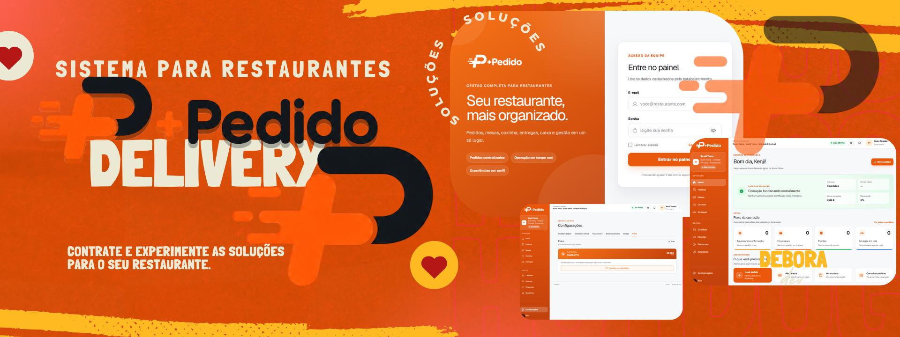

 

  

<h1 align="center">+Pedido</h1>

  Plataforma de gestão de pedidos para estabelecimentos do setor de alimentação.

  <strong>Mais organização, agilidade e controle para o seu negócio.</strong>

---

## Sobre o projeto

O **Mais Pedido** é uma plataforma SaaS desenvolvida para centralizar e simplificar a gestão de pedidos e as operações de estabelecimentos do setor de alimentação.

Com uma interface moderna e intuitiva, o sistema reúne ferramentas de gerenciamento em um único ambiente, buscando otimizar o fluxo de atendimento, facilitar o acompanhamento dos pedidos e tornar a rotina operacional mais eficiente.

A arquitetura foi planejada para atender diferentes empresas, com separação de dados e recursos de gestão por organização.

## Funcionalidades

- **Gestão de pedidos:** organização e acompanhamento dos pedidos por status.
- **Painel Kanban:** visualização do fluxo de atendimento.
- **Gerenciamento de cardápio:** administração de produtos, categorias, preços e disponibilidade.
- **Dashboard administrativo:** acesso centralizado às áreas de gestão.
- **Autenticação:** controle de acesso às áreas administrativas.
- **Arquitetura multiempresa:** estrutura voltada ao atendimento de múltiplas organizações.
- **Banco de dados:** persistência e organização das informações.
- **Gerenciamento de imagens:** suporte às imagens dos produtos.
- **Interface responsiva:** experiência adaptável a diferentes tamanhos de tela.

## Tecnologias

- Next.js
- React
- TypeScript
- Supabase
- PostgreSQL
- Tailwind CSS
- Phosphor Icons

## Arquitetura

O projeto foi estruturado com foco em modularidade, reutilização de componentes, organização do código e separação de responsabilidades.

A arquitetura busca facilitar a manutenção, a evolução das funcionalidades e a adaptação da plataforma às necessidades de diferentes estabelecimentos.

## Objetivo

Oferecer uma solução digital para tornar a gestão de pedidos mais simples e eficiente, reunindo recursos essenciais para a operação de estabelecimentos em uma plataforma centralizada.

---

  <strong>+Pedido</strong> 
  Tecnologia para simplificar a gestão e transformar a experiência de atendimento.

